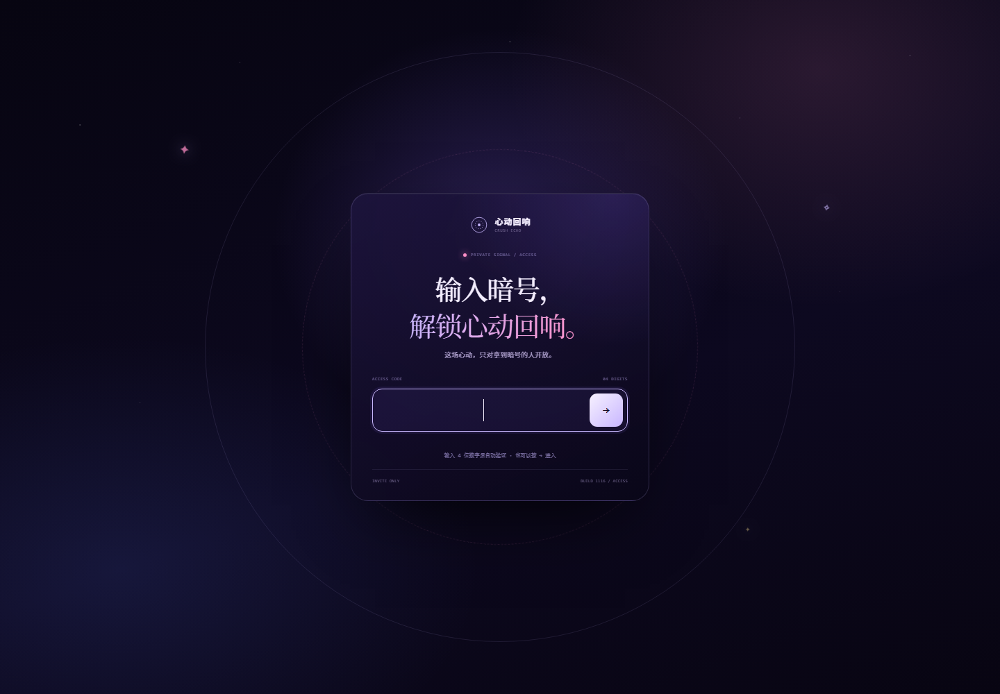
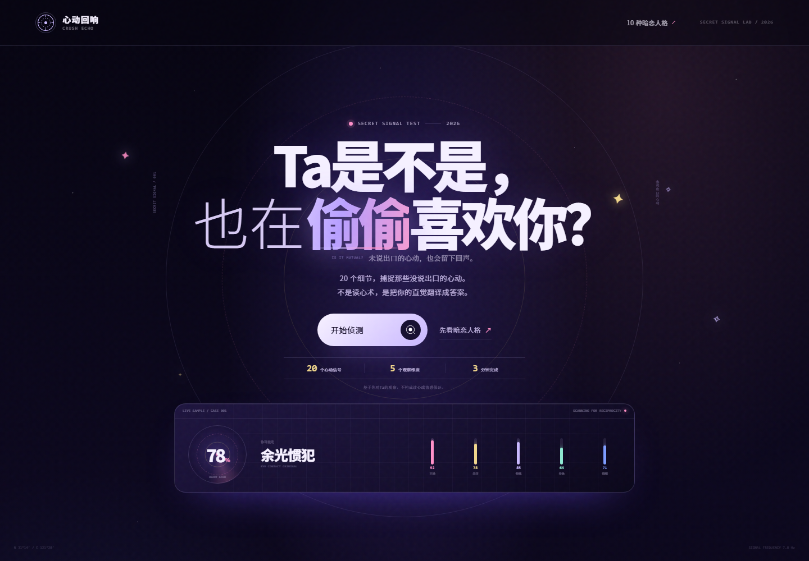
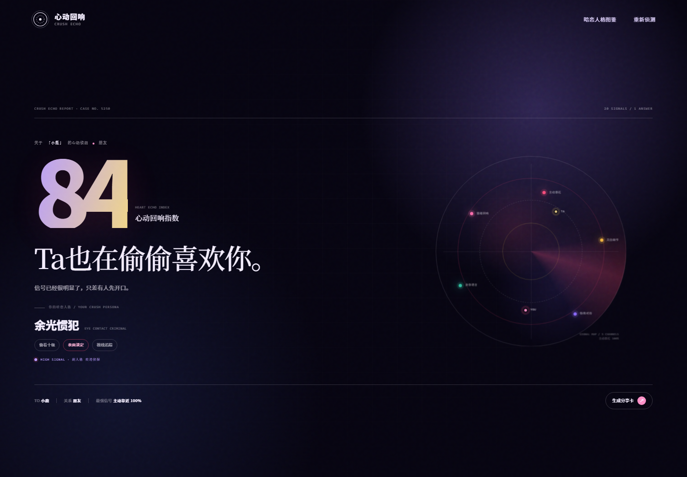
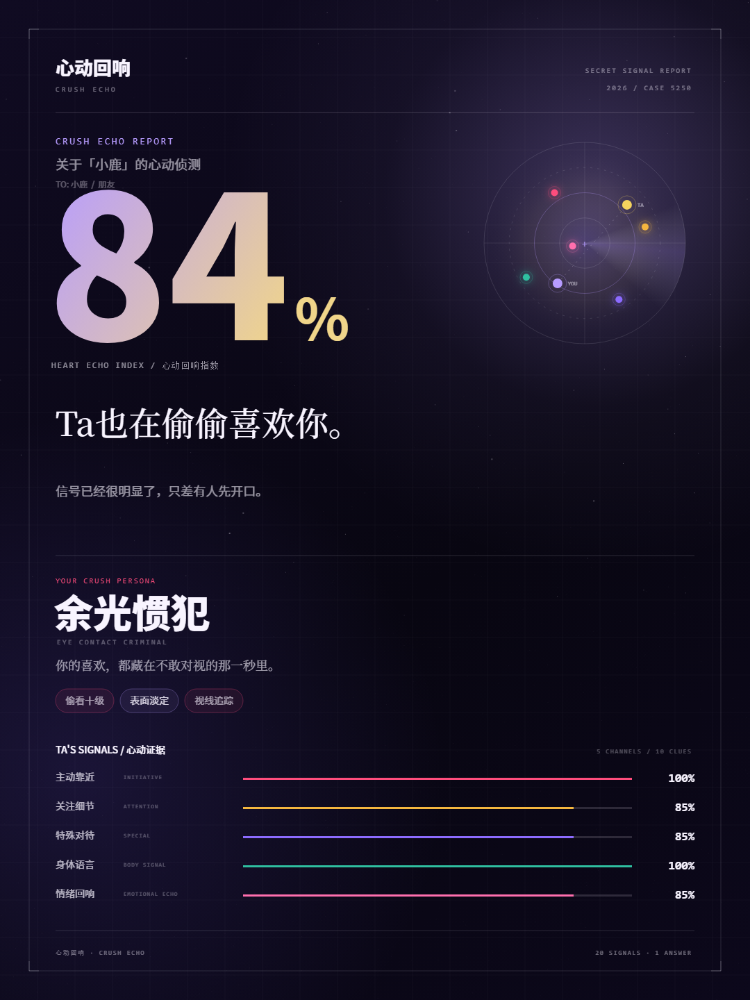

# 心动回响 · CRUSH ECHO

一个原创的「暗恋测试」网站：**Ta是不是，也在偷偷喜欢你？**

用 20 个细节，测出 Ta 的心动回响指数，也测出你在暗恋里是哪一种人格。不是传统心理测试，也不是 MBTI；它更像一台浪漫的心动信号接收器。









## 访问密码

进入页面需要输入四位暗号：`3396`。

输满四位数字后会自动验证，也可以按回车或点击箭头。验证通过后进入首页，点击「开始侦测」即可进入测试。

> 这是静态前端门禁，用于控制访问入口，不等同于服务端认证或真正的安全防护。

## 直接打开

双击 `index.html` 即可，无需安装、无需构建、无外部依赖，断网也能完整运行。

推荐最新版 Chrome / Edge / Safari。需要本地服务器时：

```bash
cd crush-echo
python -m http.server 4174
# 打开 http://localhost:4174
```

## 体验流程

1. **访问门禁**：输入四位暗号，进入星夜紫首页。
2. **设置**：给 Ta 取一个代号（可选），选择你们现在的关系阶段。
3. **Part A · 你的暗恋侧写**：10 个关于“你如何偷偷喜欢一个人”的场景题。
4. **Part B · Ta的心动证据**：10 个关于 Ta 行为的观察题，覆盖 5 个信号维度。
5. **分析**：雷达扫描 Ta 的心动频率，生成心动回响。
6. **结果**：回响指数、暗恋人格、五维证据、Ta眼中的你、下一步怎么走。
7. **分享**：生成 `1080 × 1440` PNG 分享卡，可保存、复制文案或调用系统分享。

## 10 种暗恋人格

| 人格 | English | 关键词 |
| --- | --- | --- |
| 余光惯犯 | EYE CONTACT CRIMINAL | 偷看十级 / 表面淡定 / 视线追踪 |
| 痕迹侦探 | TRACE DETECTIVE | 主页考古 / 细节控 / 暗中观察 |
| 偶遇导演 | COINCIDENCE DIRECTOR | 制造相遇 / 路线规划 / 假装路过 |
| 撤回大师 | UNSEND EXPERT | 打了又删 / 欲言又止 / 自我保护 |
| 友情区钉子户 | FRIEND ZONE SQUATTER | 友情以上 / 默默守护 / 不敢越界 |
| 阴阳试探师 | TEASE TESTER | 反话十级 / 试探大师 / 嘴硬心软 |
| 深夜小作文家 | MIDNIGHT ESSAYIST | 脑内小剧场 / 深夜 emo / 高敏感 |
| 直球预备役 | DIRECT RESERVE | 想打直球 / 草稿三版 / 等一个绿灯 |
| 装不在意冠军 | COOL PRETENDER | 口是心非 / 表面冷淡 / 偷偷在意 |
| 聊天记录考古学家 | CHAT ARCHAEOLOGIST | 记录考古 / 标点分析 / 反复回看 |

## 5 个心动信号维度

- **主动靠近 INITIATIVE**：Ta是否会主动开启对话、提出见面。
- **关注细节 ATTENTION**：Ta是否记得关于你的小事。
- **特殊对待 SPECIAL**：你是否被 Ta 放在了不一样的位置。
- **身体语言 BODY SIGNAL**：眼神、距离和那些下意识的动作。
- **情绪回响 EMOTIONAL ECHO**：Ta的情绪是否会被你牵动。

## 计分方式

- Part A 的 10 道题决定暗恋人格。每道题选择一个场景，统计各人格的出现次数；最高分是主人格，第二名是副人格。
- Part B 的 10 道题每题对应一个信号维度，选项分数为 `0—3` 分。每个维度由 2 道题组成，因此单维度原始分为 `0—6`。
- 心动回响指数由 Part B 的总分映射到 `8%—92%`，不宣称能真正读心。
- 五维百分比由各维度原始分映射到 `12%—100%`；当五个维度分数完全一致时，结果会显示“信号分布”，而不是硬选一个最弱项。
- 所有文案、百分比和人格设定都是产品叙事，不构成心理诊断或关系保证。

## 文件结构

```text
crush-echo/
├─ index.html       首页、设置、答题、分析、结果与弹层
├─ styles.css       视觉系统、雷达动效、响应式
├─ data.js          10 种人格、20 道题、5 个维度、结果文案
├─ app.js           流程、人格计分、回响指数、Canvas 分享卡
├─ preview/         页面与分享卡预览图
└─ README.md
```

## 视觉与实现

- 全站换成星夜紫深色主题：深紫夜空、淡紫星轨、星尘、金色星芒与紫色雷达，设置、答题、分析、结果和弹层保持同一套气质。
- 首页标题改成两行居中排版：轻字重「也在」作为引子、渐变「偷偷」、手绘下划线、金色星芒、衬线副题和两侧竖排注脚。
- 首页 CTA 下方是一条横向「心动回响控制台」，桌面、平板和手机首屏都能看到 78% 回响指数与暗恋人格样例。
- 中文主视觉使用 Noto Sans SC 的粗体，结果 verdict 与情绪句使用 Noto Serif SC，形成理性和诗意的对照。
- 首页星轨、控制台、暗号 ticker、结果页大号回响指数，都围绕“接收心动信号”展开。
- 分享卡由 Canvas 动态绘制，包含代号、回响指数、verdict、暗恋人格、五维证据和关系阶段。
- 无第三方依赖、无网络请求、无构建步骤；已适配 1440 / 1180 / 1024 / 740 / 390 宽度。
- 支持键盘 `1—4` 作答、返回上一题、`prefers-reduced-motion` 与基础屏幕阅读器语义。

## 说明

Ta喜不喜欢你，最终不取决于一张测试结果。它取决于你们真实的相处、表达和选择。  
这份测试只是把那些你早就注意到的细节，整理成一份更诚实的回声。
